<p align="center">
  
</p>

<p align="center">
  
</p>

<p align="center">
  <a href="https://www.linkedin.com/in/dhejasvi-jb/">
    
  </a>
  <a href="https://github.com/Dhejasvibaskar">
    
  </a>
</p>

---

## ✦ About Me

```python
class Dhejasvi:
    def __init__(self):
        self.name = "J B Dhejasvi"
        self.degree = "B.Tech AI & Data Science"
        self.college = "Rajalakshmi Engineering College"
        self.batch = "2024 - 2028"
        self.interests = [
            "Artificial Intelligence",
            "Machine Learning",
            "Data Analytics"
        ]
        self.focus = "Solving real-world problems with data"
```

I am an Artificial Intelligence and Data Science undergraduate
interested in transforming data into meaningful insights and
building practical AI-driven solutions.

My project experience includes predictive analytics, computer
vision, semantic similarity, data processing and end-to-end
AI/ML pipeline development.

I enjoy collaborating with teams, exploring new technologies
and turning ideas into functional solutions.

---

## ✦ Tech Stack

### Programming Languages


### AI, ML & Data Science


### Frameworks & Tools


---

## ✦ Featured Projects

### 🎓 AI-Assisted Transfer Credit Evaluation System

An intelligent syllabus matching and transfer credit evaluation
system using semantic similarity and AI-assisted reasoning.

- Developed semantic syllabus matching using 384-dimensional
  embeddings, cosine similarity and topic pooling.
- Implemented threshold-based decisions, gap identification,
  bridge module recommendations and human-in-the-loop evaluation.

**Tech Stack:** Python · Sentence Transformers · Gemini API · FastAPI

---

### 🛣️ Road Accident Blackspot Prediction & Safer Route Recommendation

A data-driven geospatial solution for identifying accident-prone
locations and recommending safer routes.

- Analyzed 500K+ UK collision records from 2021–2025.
- Performed data cleaning, exploratory data analysis and
  severity-weighted blackspot scoring.
- Achieved 18.19% hotspot coverage against a 4.91% random
  baseline through holdout validation.

**Tech Stack:** Python · Pandas · NumPy · SciPy · Matplotlib ·
Seaborn · Leaflet · OSRM

[View Repository](https://github.com/Dhejasvibaskar/Road-Accident-Blackspot-Prediction)

---

### 🔍 TRACE AI — Intelligent Legal Metrology Compliance System

An AI-powered system for automated product label compliance
verification.

**Role:** ML Technical Lead & Co-Presenter

- Led the development of an AI/ML pipeline integrating image
  preprocessing, classification, OCR and rule-based verification.
- Achieved 100% agreement on the compliance rule test suite.
- Recorded an average processing latency of 8.92 seconds.
- Selected among the Top 50 teams in REC's internal SIH competition.

**Tech Stack:** Python · OpenCV · CLIP · EasyOCR · PaddleOCR ·
FastAPI · SQLite

---

### ⚡ Amplytics — Smart Meter Intelligence Platform

An intelligent analytics platform for electricity demand
forecasting and anomaly detection.

- Led a four-member technical team.
- Developed analytics across 50 simulated smart meters in
  five feeder zones.
- Built explainable risk classification, multi-signal alerts,
  inspection reports and interactive dashboards.

**Tech Stack:** Python · Pandas · NumPy · XGBoost · Scikit-learn ·
Streamlit · Plotly

[View Repository](https://github.com/Dhejasvibaskar/amplytics-smart-meter-intelligence)

---

## ✦ Experience

**Web Development Intern**  
Altruisty Innovation Pvt Ltd, Guindy

---

## ✦ Education

**B.Tech — Artificial Intelligence and Data Science**  
Rajalakshmi Engineering College  
2024 – 2028

---

## ✦ Achievements

🏆 **Smart India Hackathon — REC Internal Selection**

Selected among the Top 50 teams in Rajalakshmi Engineering
College's internal SIH competition.

---

## ✦ Certifications & Learning

- Kaggle — Pandas
- Kaggle — Data Cleaning
- MongoDB Basics for Students
- Tata GenAI with Data Analytics
- Deloitte Data Analytics Job Simulation

---

## ✦ GitHub Statistics

<p align="center">
  
</p>

<p align="center">
  
</p>

---

<p align="center">
  <i>Building meaningful solutions, one line of code at a time.</i>
</p>
